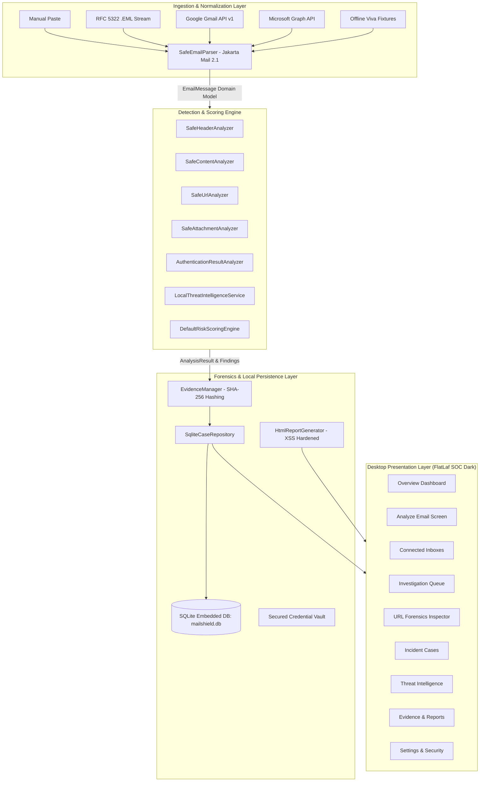
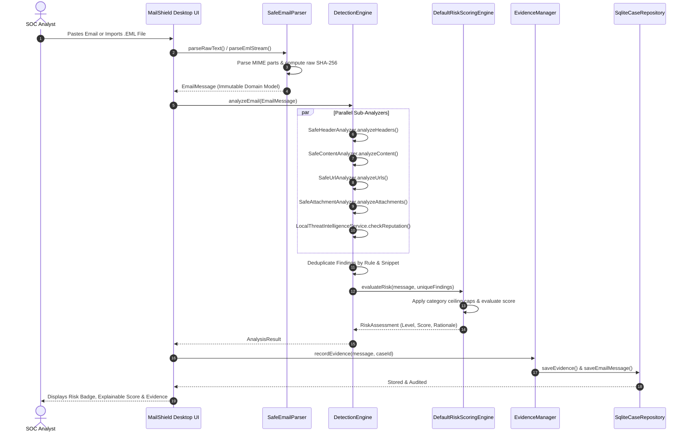

# MailShield Architecture, Ingestion & Detection Engine Specifications

## 1. System Architecture Overview

MailShield is structured according to clean layered architecture principles, ensuring strict separation of presentation (Swing/FlatLaf), domain modeling, ingestion adapters, detection heuristics, and persistence.

---

## 2. Detection Pipeline Sequence

---

## 3. Explainable Risk Scoring Engine

### Scoring Philosophy:
Traditional anti-spam filters often suffer from **correlated score inflation** (e.g., an email mentioning an "urgent deadline" multiple times gets heavily penalized in duplicate). MailShield employs **Category Ceiling Caps** to avoid multi-counting while guaranteeing that any confirmed critical threat (such as a disguised executable payload or bare IP phishing lure) immediately elevates the baseline verdict.

### Category Ceiling Caps:
| Detection Category | Base Rule Points | Max Category Contribution | Rational & Mitigation |
|---|---|---|---|
| `SUSPICIOUS_ATTACHMENT` | 35 - 50 | **50 pts** | High lethal potential (executables, double extensions) |
| `SUSPICIOUS_URL` | 20 - 35 | **45 pts** | Deceptive anchor text mismatch, IP hosts, homoglyphs |
| `THREAT_INTELLIGENCE` | 20 - 40 | **45 pts** | Flagged reputation matches from verified feeds |
| `SPOOFING_IMPERSONATION`| 20 - 35 | **40 pts** | Display-name executive spoofing, embedded emails |
| `AUTHENTICATION_FAILURE`| 15 - 30 | **35 pts** | Parsed SPF fail, DKIM fail, DMARC alignment fail |
| `SOCIAL_ENGINEERING` | 15 - 25 | **30 pts** | Urgency, account suspension threats, wire transfers |
| `HEADER_ANOMALY` | 5 - 20 | **25 pts** | From vs Reply-To domain divergence, Return-Path |
| `CONTENT_HEURISTIC` | 5 - 15 | **20 pts** | Formatting and minor stylistic anomalies |

### Risk Level Thresholds:
- **0 - 24 / 100:** `LOW RISK` (Benign email, passed standard checks)
- **25 - 54 / 100:** `MEDIUM RISK` (Anomalies observed; exercise caution)
- **55 - 79 / 100:** `HIGH RISK` (Strong threat indicators present; secondary channel verification required)
- **80 - 100 / 100:** `CRITICAL THREAT` (Confirmed malicious payload, severe spoofing, or deceptive phishing lure)
- `INSUFFICIENT_DATA`: Missing headers and body (cannot reach a valid verdict)

